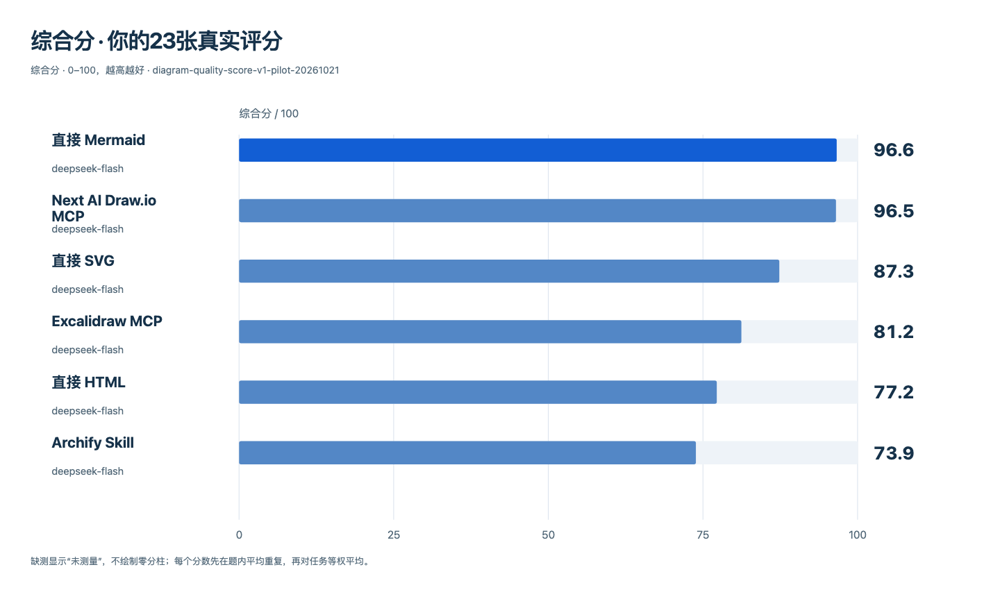
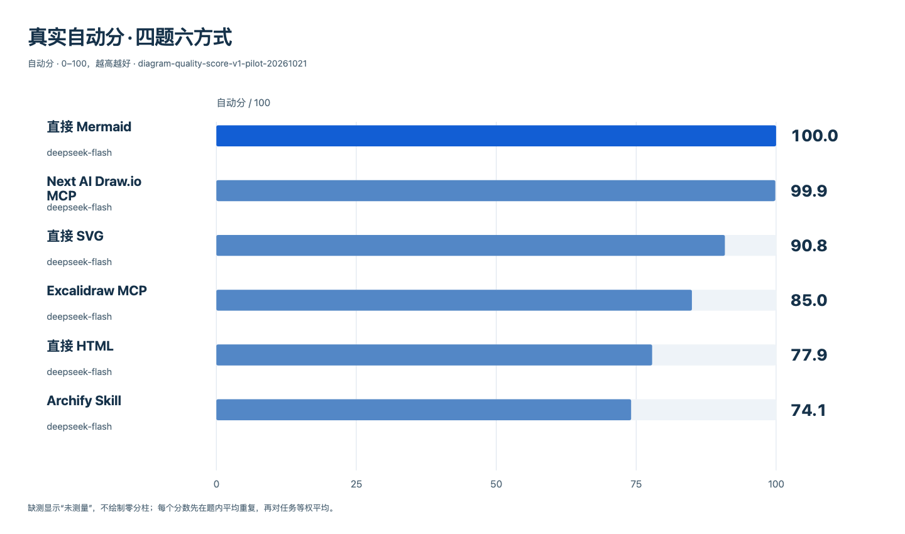

# 四题六方式：真实生成实验与人工评分

同一deepseek-flash、相同四题、相同生成与修复预算。24格自动计分完整；23张成功交付的图由一位独立人工评审完成五项1–5分评分。

| 方法 | 自动分 | 人评 H | 综合分 | 交付 |
| --- | ---: | ---: | ---: | ---: |
| 直接 Mermaid | 100.0 | 77.5 | **96.6** | 4/4 |
| Next AI Draw.io MCP | 99.9 | 77.5 | **96.5** | 4/4 |
| 直接 SVG | 90.8 | 67.5 | **87.3** | 4/4 |
| Excalidraw MCP | 85.0 | 60.0 | **81.2** | 4/4 |
| 直接 HTML | 77.9 | 73.8 | **77.2** | 4/4 |
| Archify Skill | 74.1 | 72.5 | **73.9** | 3/4 |

综合分 = 85%自动分 + 15%人评H。所有方法四题同权；未交付题贡献0。自动分独立保留，可用于无人参与的优化。

## Archify低分来自一道题交付失败

Archify成功交付3/4题；退货题三次提交均被原生finalize拒绝：前两次是drop路由与端点方向冲突，第三次是显式路由交叉。该题按既定规则计0，拉低整组平均；失败没有从分母中删除。

成功交付三张图的人工观感均分为96.7/100；排版、风格、审美三项均为5/5。含未交付题后，人评H为72.5、综合分73.9。数据同时反映成功图的观感和交付可靠性，后续优化可优先从退货题的约束冲突与修复收敛入手。

## 原图与可复核记录

- [23张真实图、48次候选源码及原生可编辑文件](gallery.md)
- [完整数值与五项人评均值](results.json)、[CSV](scores.csv)
- [原始五项人工评分及作品/预览hash](human-reviews.json)
- [逐题调用usage、原始响应ID、时间、修复记录和原生诊断](runs.json)
- [打包文件hash](manifest.json)

## 实验条件

模型deepseek-flash，temperature0.2，thinking disabled，单次输出8192上限。每格最多3次提交，600秒、200000输入输出tokens、USD0.25预算。六种方式共用完整文档预加载、原生提交、真实诊断与至多两次修复的流程；Archify使用Architecture v1与Workflow v2并执行finalize showcase。

Archify实验源码固定在d3597bb6，比较基础为e49cfd2aff5bc9839332367b5b12c862a97c08ac。Next AI Draw.io MCP源码6cc5cd7925777a141e4b278d0017dfbcc8cdfef2，MCP0.4.6/draw.io32.0.2；Excalidraw MCP源码157aa23ceb1976008aadc89eb05e3444060f09d6，原生Excalidraw0.18.0。图像以浅色媒体、完整原生画布展示；原始候选源码未改。

48次调用输入657434、输出33420，共690854tokens，按对应官方USD费率核算0.038511528美元。缓存命中和未命中逐次保留。验收器更正后对同一批产物6路并发重评，没有新增模型调用。

本次是四道公开开发/校准题的一次小样本实验，用于检验benchmark与定位问题。人评是一位评审的结果，正式双人共识规则仍保留。速度、成本分有固定满分锚点，可结合runs.json的原始单位查看差异。
