# 本次实验的实际生成图

四题、六种方式，同一deepseek-flash。图片为模型最终候选的真实渲染，保留原生样式；点击源码可查看模型原始提交。Archify退货题未交付，保留三次失败源码和诊断。

## 售票架构与返回关系（architecture-01）

### Archify Skill

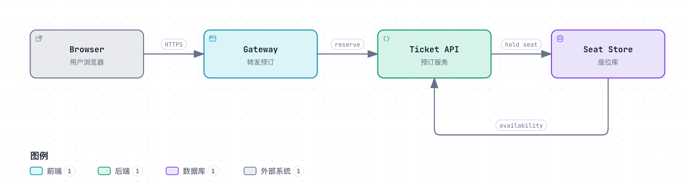

[最终候选源码](cases/architecture-01/archify/candidate-3.json)

[提交1](cases/architecture-01/archify/candidate-1.json) · [提交2](cases/architecture-01/archify/candidate-2.json) · [提交3](cases/architecture-01/archify/candidate-3.json)

### 直接 Mermaid

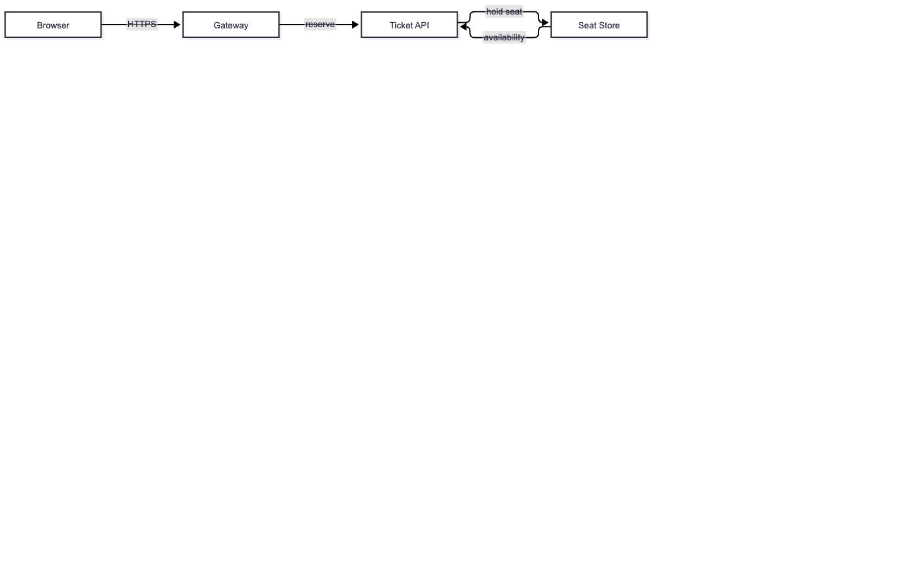

[最终候选源码](cases/architecture-01/mermaid/candidate-1.mmd)

[提交1](cases/architecture-01/mermaid/candidate-1.mmd)

### 直接 SVG

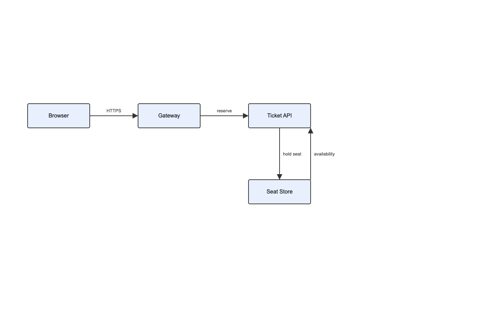

[最终候选源码](cases/architecture-01/svg/candidate-1.svg)

[提交1](cases/architecture-01/svg/candidate-1.svg)

### 直接 HTML

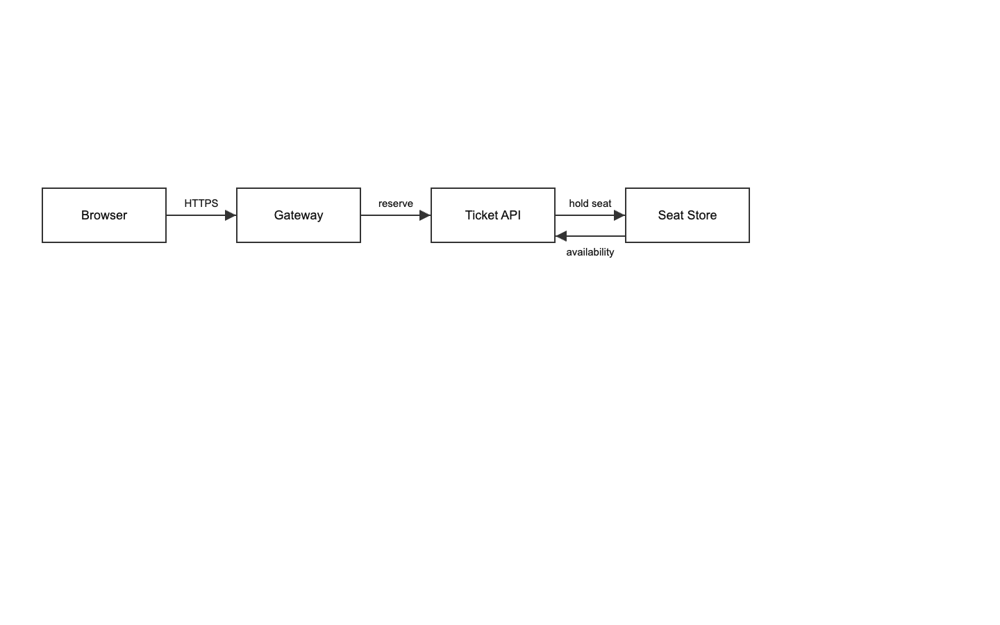

[最终候选源码](cases/architecture-01/html/candidate-1.html)

[提交1](cases/architecture-01/html/candidate-1.html)

### Next AI Draw.io MCP

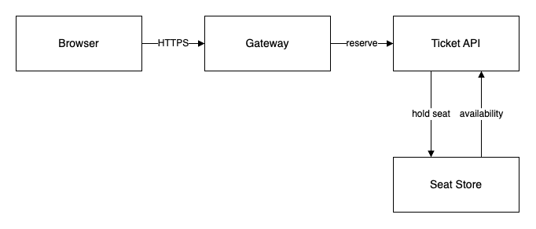

[最终候选源码](cases/architecture-01/drawio/candidate-1.xml) · [原生可编辑文件](cases/architecture-01/drawio/diagram.drawio)

[提交1](cases/architecture-01/drawio/candidate-1.xml)

### Excalidraw MCP

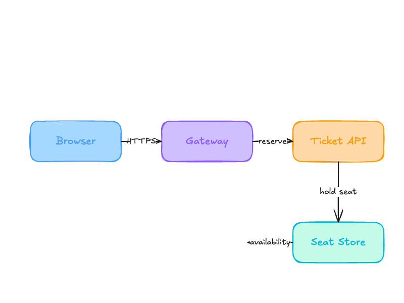

[最终候选源码](cases/architecture-01/excalidraw/candidate-3.json) · [原生可编辑文件](cases/architecture-01/excalidraw/diagram.excalidraw)

[提交1](cases/architecture-01/excalidraw/candidate-1.json) · [提交2](cases/architecture-01/excalidraw/candidate-2.json) · [提交3](cases/architecture-01/excalidraw/candidate-3.json)

## 权限审核与分支（workflow-01）

### 直接 Mermaid

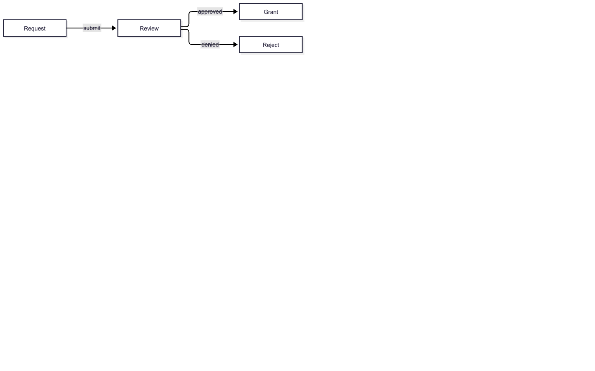

[最终候选源码](cases/workflow-01/mermaid/candidate-1.mmd)

[提交1](cases/workflow-01/mermaid/candidate-1.mmd)

### 直接 SVG

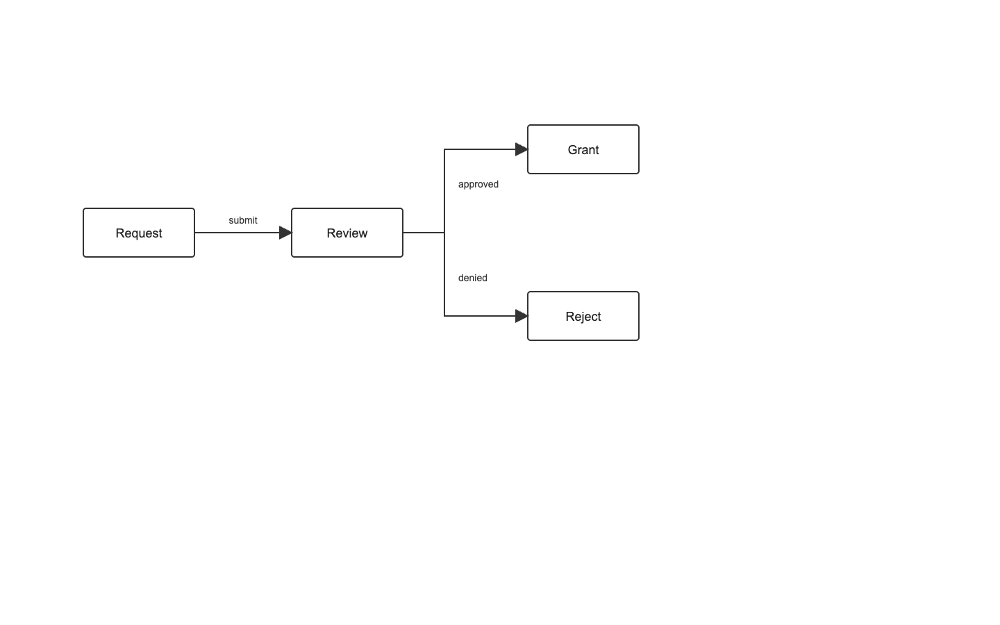

[最终候选源码](cases/workflow-01/svg/candidate-1.svg)

[提交1](cases/workflow-01/svg/candidate-1.svg)

### 直接 HTML

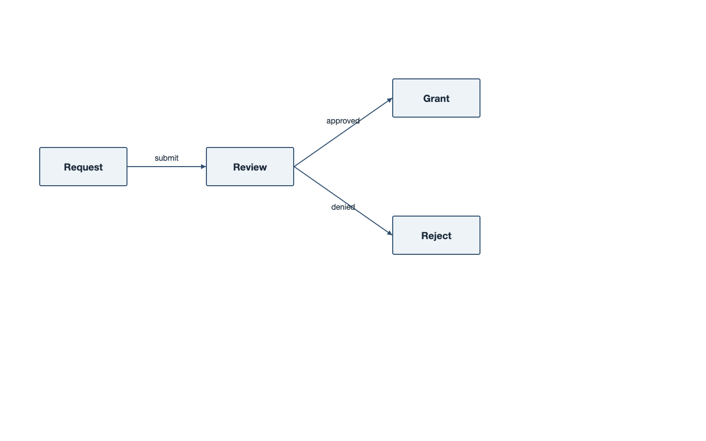

[最终候选源码](cases/workflow-01/html/candidate-1.html)

[提交1](cases/workflow-01/html/candidate-1.html)

### Next AI Draw.io MCP

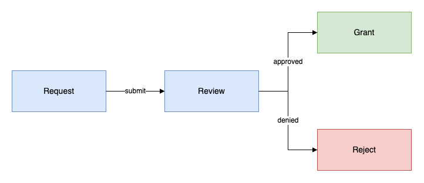

[最终候选源码](cases/workflow-01/drawio/candidate-1.xml) · [原生可编辑文件](cases/workflow-01/drawio/diagram.drawio)

[提交1](cases/workflow-01/drawio/candidate-1.xml)

### Excalidraw MCP

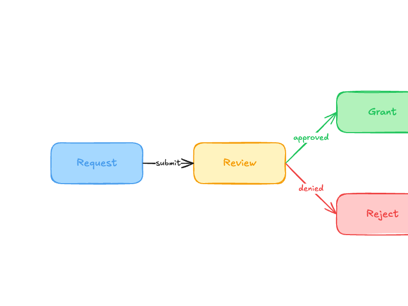

[最终候选源码](cases/workflow-01/excalidraw/candidate-1.json) · [原生可编辑文件](cases/workflow-01/excalidraw/diagram.excalidraw)

[提交1](cases/workflow-01/excalidraw/candidate-1.json)

### Archify Skill

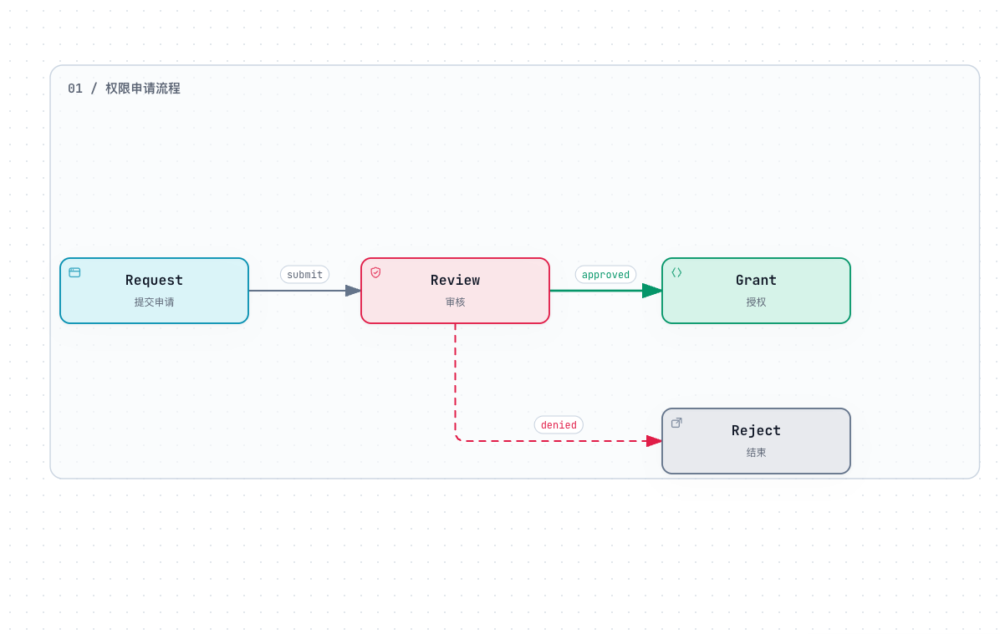

[最终候选源码](cases/workflow-01/archify/candidate-3.json)

[提交1](cases/workflow-01/archify/candidate-1.json) · [提交2](cases/workflow-01/archify/candidate-2.json) · [提交3](cases/workflow-01/archify/candidate-3.json)

## 库存、支付与审计（architecture-04）

### 直接 SVG

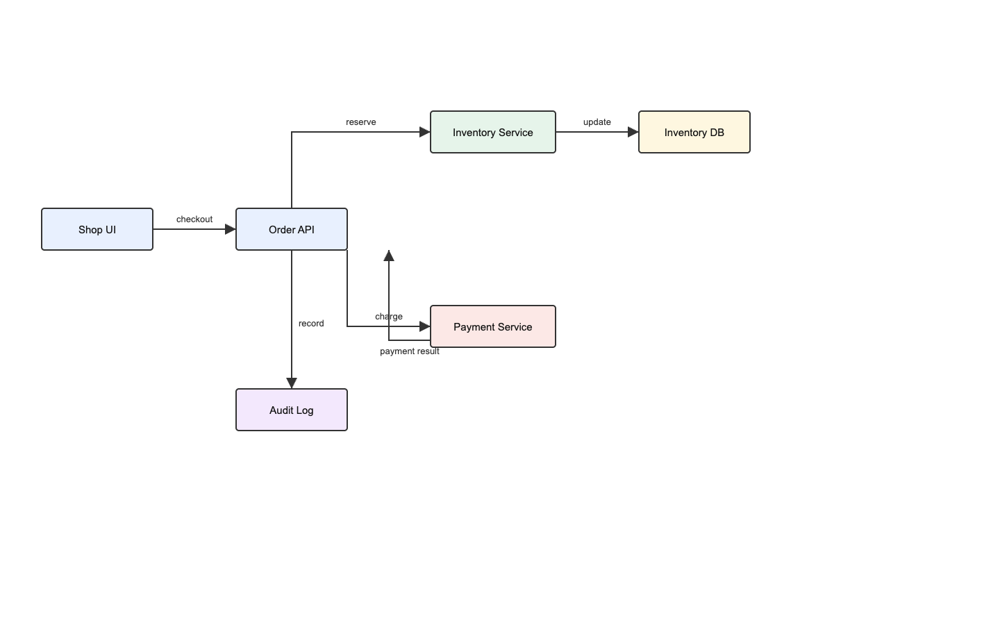

[最终候选源码](cases/architecture-04/svg/candidate-3.svg)

[提交1](cases/architecture-04/svg/candidate-1.svg) · [提交2](cases/architecture-04/svg/candidate-2.svg) · [提交3](cases/architecture-04/svg/candidate-3.svg)

### 直接 HTML

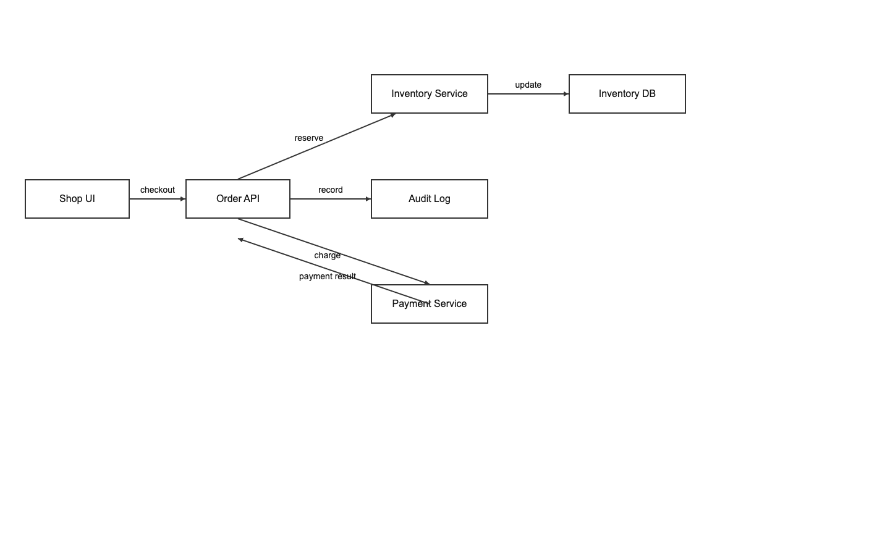

[最终候选源码](cases/architecture-04/html/candidate-3.html)

[提交1](cases/architecture-04/html/candidate-1.html) · [提交2](cases/architecture-04/html/candidate-2.html) · [提交3](cases/architecture-04/html/candidate-3.html)

### Next AI Draw.io MCP

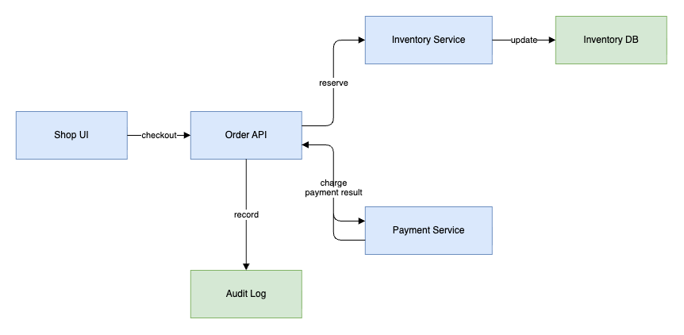

[最终候选源码](cases/architecture-04/drawio/candidate-3.xml) · [原生可编辑文件](cases/architecture-04/drawio/diagram.drawio)

[提交1](cases/architecture-04/drawio/candidate-1.xml) · [提交2](cases/architecture-04/drawio/candidate-2.xml) · [提交3](cases/architecture-04/drawio/candidate-3.xml)

### Excalidraw MCP

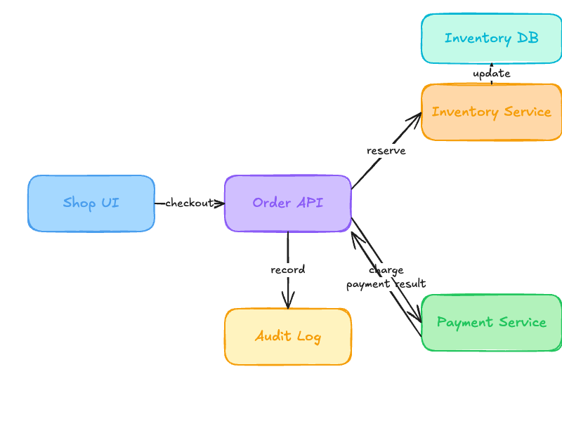

[最终候选源码](cases/architecture-04/excalidraw/candidate-3.json) · [原生可编辑文件](cases/architecture-04/excalidraw/diagram.excalidraw)

[提交1](cases/architecture-04/excalidraw/candidate-1.json) · [提交2](cases/architecture-04/excalidraw/candidate-2.json) · [提交3](cases/architecture-04/excalidraw/candidate-3.json)

### Archify Skill

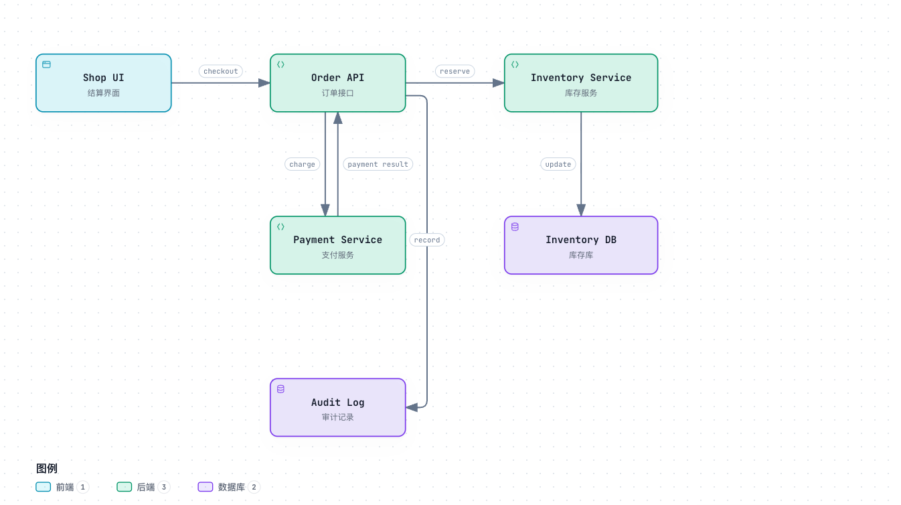

[最终候选源码](cases/architecture-04/archify/candidate-3.json)

[提交1](cases/architecture-04/archify/candidate-1.json) · [提交2](cases/architecture-04/archify/candidate-2.json) · [提交3](cases/architecture-04/archify/candidate-3.json)

### 直接 Mermaid

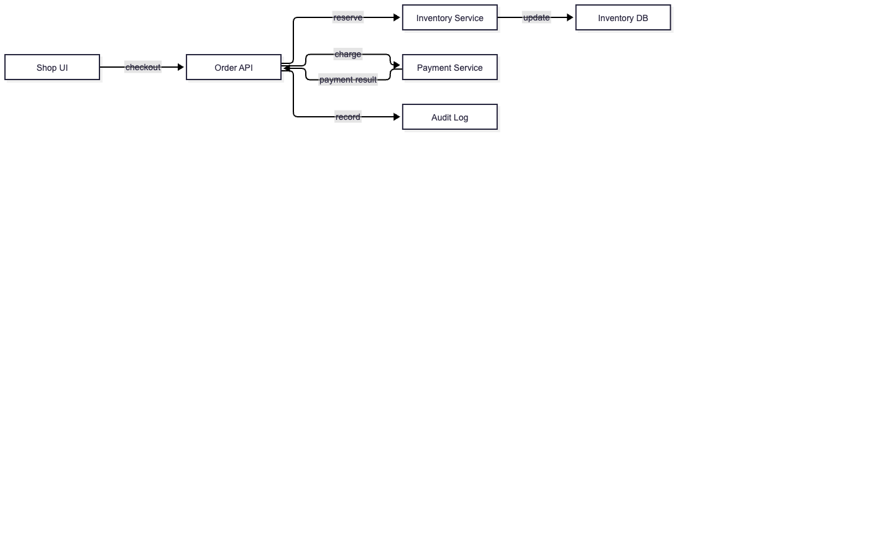

[最终候选源码](cases/architecture-04/mermaid/candidate-1.mmd)

[提交1](cases/architecture-04/mermaid/candidate-1.mmd)

## 退货处理与分支汇合（workflow-04）

### 直接 HTML

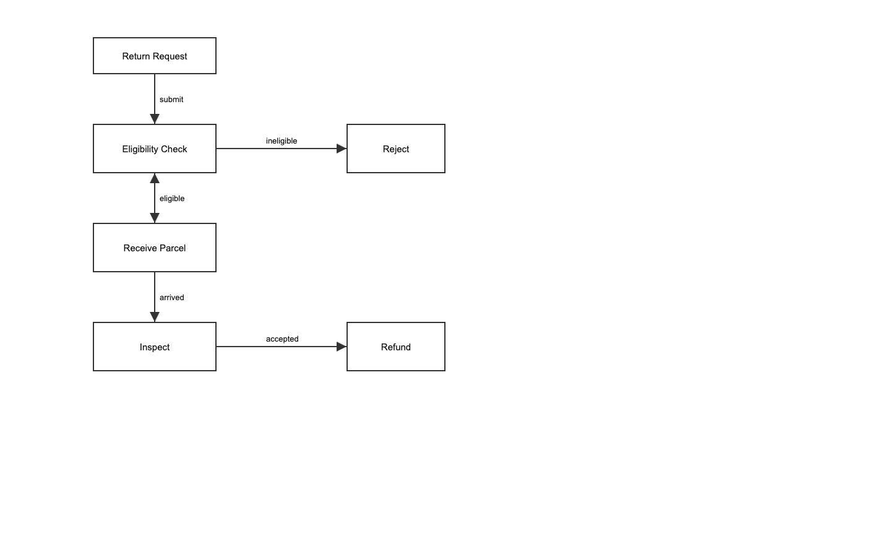

[最终候选源码](cases/workflow-04/html/candidate-3.html)

[提交1](cases/workflow-04/html/candidate-1.html) · [提交2](cases/workflow-04/html/candidate-2.html) · [提交3](cases/workflow-04/html/candidate-3.html)

### Next AI Draw.io MCP

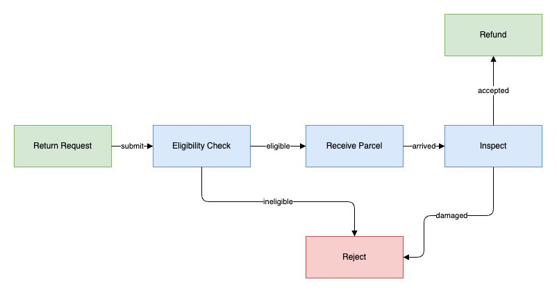

[最终候选源码](cases/workflow-04/drawio/candidate-1.xml) · [原生可编辑文件](cases/workflow-04/drawio/diagram.drawio)

[提交1](cases/workflow-04/drawio/candidate-1.xml)

### Excalidraw MCP

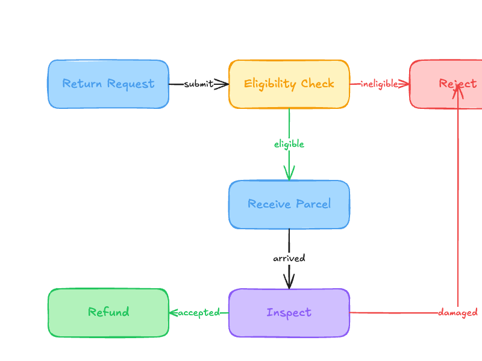

[最终候选源码](cases/workflow-04/excalidraw/candidate-3.json) · [原生可编辑文件](cases/workflow-04/excalidraw/diagram.excalidraw)

[提交1](cases/workflow-04/excalidraw/candidate-1.json) · [提交2](cases/workflow-04/excalidraw/candidate-2.json) · [提交3](cases/workflow-04/excalidraw/candidate-3.json)

### Archify Skill

未交付；三次提交均被原生 finalize 拒绝。

[提交1](cases/workflow-04/archify/candidate-1.json) · [提交2](cases/workflow-04/archify/candidate-2.json) · [提交3](cases/workflow-04/archify/candidate-3.json)

### 直接 Mermaid

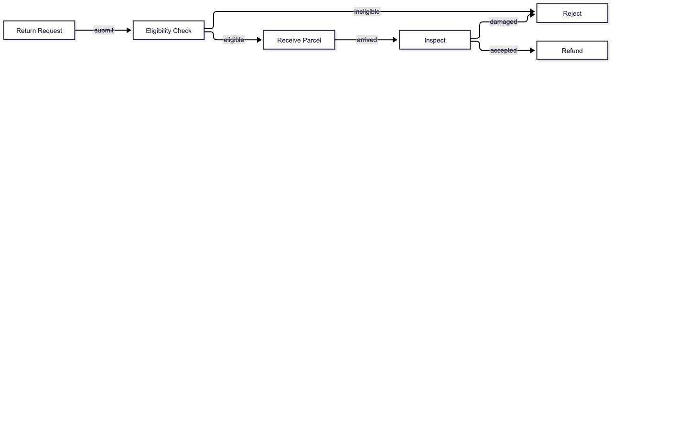

[最终候选源码](cases/workflow-04/mermaid/candidate-3.mmd)

[提交1](cases/workflow-04/mermaid/candidate-1.mmd) · [提交2](cases/workflow-04/mermaid/candidate-2.mmd) · [提交3](cases/workflow-04/mermaid/candidate-3.mmd)

### 直接 SVG

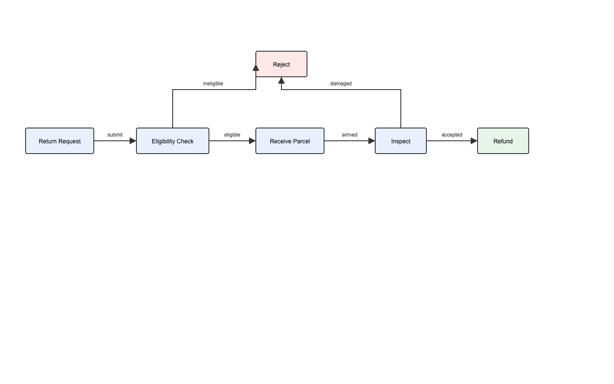

[最终候选源码](cases/workflow-04/svg/candidate-1.svg)

[提交1](cases/workflow-04/svg/candidate-1.svg)
